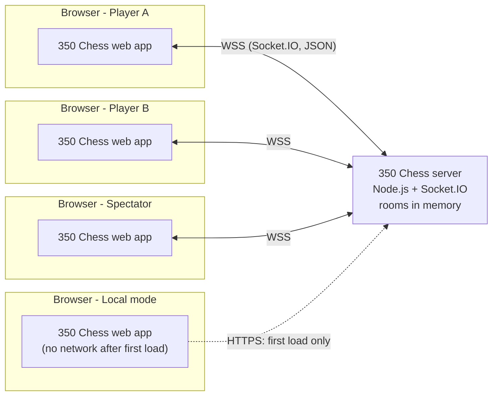
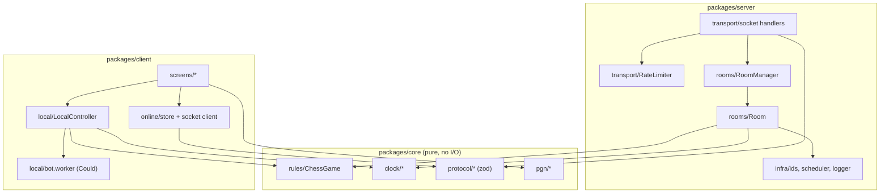
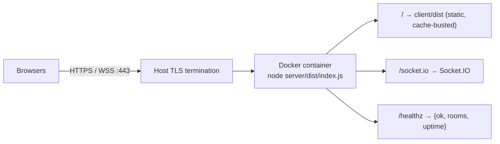
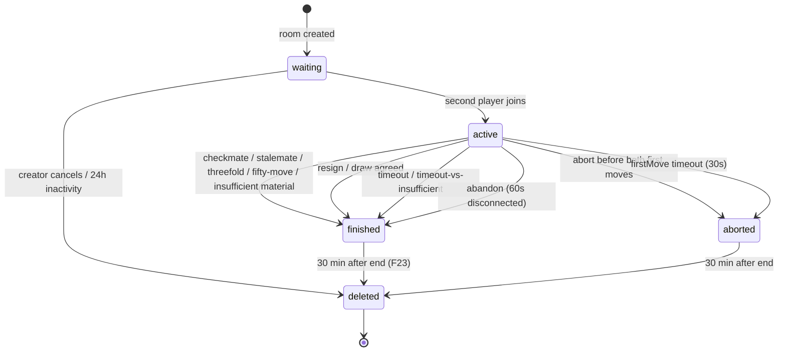
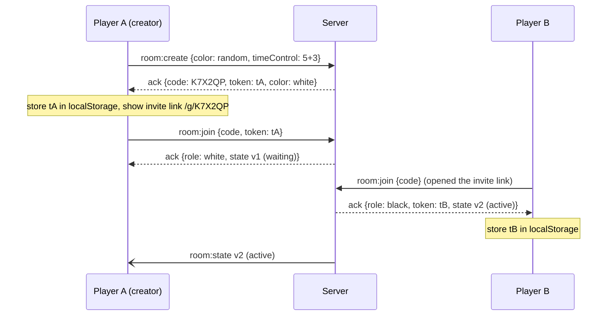
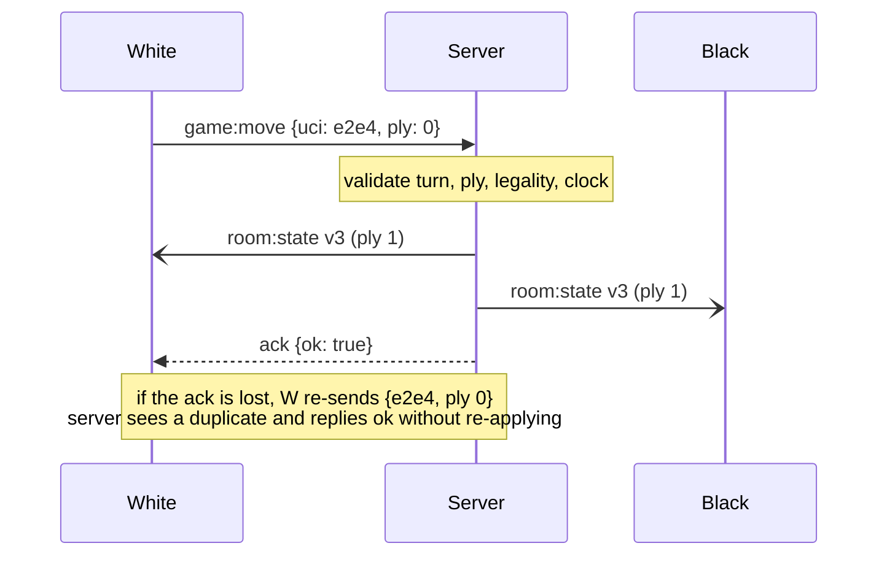
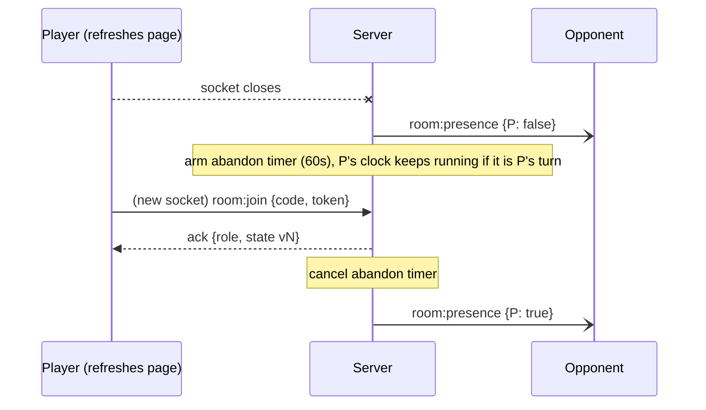
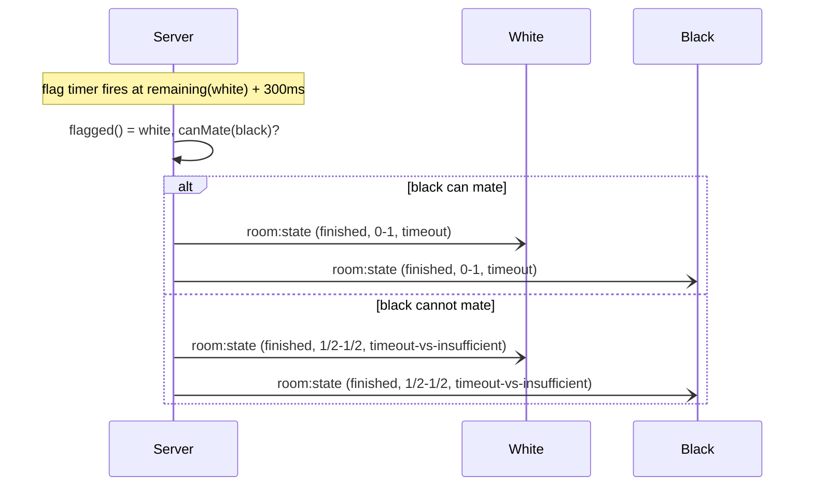

# 350 Chess — Software Design Document (SDD)

|                    |                                                                        |
| ------------------ | ---------------------------------------------------------------------- |
| **Project**        | 350 Chess — web-based chess with online (invite code) and local play   |
| **Client SRS**     | _Chess: Software Requirements Specification_, Team 3 (`Team3_SRS.pdf`) |
| **Client team**    | Team 3 — Alexis Rodet, Ahmed Ouarda, Marcell Vizhanyo, Ors Mandli      |
| **Developer team** | Team _TBD_ — _member names TBD_                                        |
| **Course**         | CS350 Introduction to Software Engineering, KAIST, 2026                |
| **Version**        | 0.2 — draft, 2026-11-09 (Checkpoint 1: offline local mode implemented) |
| **Status**         | Draft. To be reviewed with the client at Sync 1 (see §21).             |

> This document is the single source of truth for _how_ we build the system the SRS describes.
> If code and this document disagree, one of them is a bug: fix the code or update this document in the same PR.

---

## 1. Introduction

### 1.1 Purpose

This SDD turns the client's SRS into a buildable design: architecture, components, data model, network protocol, game-lifecycle rules, testing strategy, development process and plan.
Readers are the developer team, the client team, the course staff, and the AI coding agents the team uses (see `AGENTS.md`).

### 1.2 Scope

Same scope as the SRS:

- **Online mode** — two remote players join a server-side _room_ via a short _invite code_ or link. Optional spectators. The server validates every move and is the source of truth.
- **Local mode** — two players share one device. No server, works offline after first load.
- No accounts, no logins, no database.

**Out of scope** (SRS §1.2): user accounts, matchmaking, ratings/leaderboards, engine analysis, chess variants, permanent game storage, native mobile apps.
AI opponent: listed both as out of scope (§1.2) and as a _Could_ requirement (F15). We treat it as an optional stretch goal (see A3).

### 1.3 References

1. Team 3, _Chess: Software Requirements Specification_ (the SRS).
2. FIDE Laws of Chess.
3. PGN Specification (Portable Game Notation).
4. RFC 6455 — The WebSocket Protocol.
5. Socket.IO v4 documentation.
6. chess.js documentation.
7. lichess.org (open source: `lila`, `lila-ws`, `scalachess`) — used as prior art; see Appendix A.

### 1.4 Definitions

| Term          | Meaning                                                                                                 |
| ------------- | ------------------------------------------------------------------------------------------------------- |
| Room          | Server-side game session, identified by an invite code. Holds the game, seats, clock, chat.             |
| Invite code   | 6-character random code, e.g. `K7X2QP`. Public: anyone with it can watch.                               |
| Invite link   | `https://<host>/g/<CODE>` — the same thing as a URL.                                                    |
| Seat          | The white or black player slot of a room.                                                               |
| Player token  | 256-bit random secret proving ownership of a seat. Stored only in the player's browser. Never in a URL. |
| Spectator     | Connected user without a seat. Read-only (plus chat).                                                   |
| Ply           | One half-move. Ply 0 = start position, white to move.                                                   |
| UCI move      | Move as `from+to[+promotion]`, e.g. `e2e4`, `e7e8q`. Wire format for moves.                             |
| SAN           | Standard Algebraic Notation, e.g. `Nf3`, `exd5`, `O-O`. Display format.                                 |
| FEN           | Forsyth–Edwards Notation, a one-line board position.                                                    |
| Snapshot      | The full public state of a room (`RoomState`), sent after every change.                                 |
| Version (`v`) | Monotonic counter per room, incremented on every state change.                                          |
| Abort         | Cancelling a game before both players have moved. Produces no result.                                   |
| Abandon       | A player stays disconnected during an active game past the grace period. Counts as a loss.              |

### 1.5 SRS interpretations and assumptions

The SRS has a few ambiguities and inconsistencies. We use the interpretations below until the client confirms or changes them at Sync 1. Every confirmed change is recorded in the change log (Appendix B).

| ID  | SRS item                             | Issue                                                                                      | Our interpretation                                                                                                                                                   | Status     |
| --- | ------------------------------------ | ------------------------------------------------------------------------------------------ | -------------------------------------------------------------------------------------------------------------------------------------------------------------------- | ---------- |
| A1  | F22 (twice)                          | Two different requirements share ID F22.                                                   | **F22** = step through moves after the game (_Should_). **F22b** = review with branching lines (_Could_).                                                            | To confirm |
| A2  | F20 Accounts, F21 Permanent history  | Listed as _Could_ but also out of scope in §1.2.                                           | Out of scope. Not implemented.                                                                                                                                       | To confirm |
| A3  | F15 AI bot (≥1500 Elo)               | Conflicts with "AI opponents out of scope".                                                | _Could_ stretch goal, local mode only. Licensing note in ADR-010 (`AGENTS.md`).                                                                                      | To confirm |
| A4  | F3 draw rules                        | FIDE threefold repetition and the 50-move rule are _claimable_, not automatic.             | Game ends **automatically** on threefold repetition, 50-move rule, insufficient material and stalemate. Simpler and what the SRS literally says ("detect").          | To confirm |
| A5  | F16 clocks                           | Not specified: what happens when a player flags while the opponent has no mating material. | **Draw**, per FIDE Art. 6.9.                                                                                                                                         | Proposed   |
| A6  | F11 "full room" vs F18 spectators    | If seats are full, is a joiner rejected or a spectator?                                    | Joiner becomes a **spectator**. `ROOM_FULL` is returned only when the spectator cap (50) is reached.                                                                 | To confirm |
| A7  | F10 abandonment                      | Timeout value not given.                                                                   | **60 s** reconnect grace, then the connected opponent wins by abandonment.                                                                                           | To confirm |
| A8  | F16 clocks                           | When do clocks start?                                                                      | Clocks start after **both** players have made their first move (lichess behaviour). If a player does not make a first move within **30 s**, the game is **aborted**. | Proposed   |
| A9  | F13 undo vs F16 clocks in local mode | Undo with a running clock is ill-defined.                                                  | Undo/redo is available in **untimed** local games only.                                                                                                              | To confirm |
| A10 | Product name                         | "350 Chess" vs "OnlineChess".                                                              | **350 Chess**.                                                                                                                                                       | To confirm |
| A11 | F4 draw offers                       | Lifetime of an offer not given.                                                            | At most one pending offer. It stands until the opponent accepts, declines, or makes a move (a move declines it). A player may offer at most once per own move.       | Proposed   |
| A12 | F6 colour "random"                   | When is it resolved?                                                                       | At room creation, server-side, using a CSPRNG.                                                                                                                       | Proposed   |

---

## 2. System overview



- **One server process** serves the static web app and the real-time API on the same origin over HTTPS/WSS.
- **Online mode:** clients send _commands_ (`move`, `resign`, …). The server validates them, updates the room and broadcasts a full _snapshot_.
- **Local mode:** the same rules engine runs inside the browser. No server.

---

## 3. Design principles

These are the non-negotiable rules. Every design decision below follows from them.

| #   | Principle                                                                                                                     | Why                                                                                                   |
| --- | ----------------------------------------------------------------------------------------------------------------------------- | ----------------------------------------------------------------------------------------------------- |
| P1  | **The server is the single source of truth** in online mode. The client never decides legality, turn order, time, or results. | SRS 2.1 and 5.2: "the client is never trusted".                                                       |
| P2  | **A pure domain core** (rules, clock, protocol schemas) with no I/O, shared by client and server.                             | One implementation of the rules. Unit-testable in milliseconds.                                       |
| P3  | **Full, versioned snapshots** after every change, not deltas.                                                                 | No client/server desync bugs. Reconnect needs no special replay logic. Payloads stay small (< 10 KB). |
| P4  | **Idempotent commands with acknowledgements.**                                                                                | Network retries never double-apply a move.                                                            |
| P5  | **Time is injected.** No module calls `Date.now()` or `setTimeout` directly, only through an injected clock/scheduler.        | Clock and timeout logic can be tested deterministically, without waiting.                             |
| P6  | **Fail closed.** Every inbound message is schema-validated. Unknown or invalid input is rejected with an error code.          | Robustness and security.                                                                              |
| P7  | **Simplicity first (YAGNI).** One process, no database, no microservices, no premature optimisation.                          | Small team, about 5 weeks. The SRS explicitly allows in-memory rooms.                                 |
| P8  | **Traceability.** Every SRS requirement maps to code, to tests and to an issue (§17).                                         | Verifiable delivery, and evidence for the final report.                                               |

---

## 4. Technology stack

All versions are the latest stable at scaffold time, pinned via `package-lock.json` and `.nvmrc`.

| Concern                | Choice                                                             | License      | Rationale                                                                                                                                                             |
| ---------------------- | ------------------------------------------------------------------ | ------------ | --------------------------------------------------------------------------------------------------------------------------------------------------------------------- |
| Language               | TypeScript (`strict: true`) everywhere                             | Apache-2.0   | Shared types between client and server. Catches protocol mismatches at compile time.                                                                                  |
| Runtime                | Node.js, current LTS                                               | MIT          | Same language as the client. Single-threaded event loop makes room updates race-free (§7.3).                                                                          |
| Chess rules            | **chess.js**                                                       | BSD-2-Clause | Complete FIDE move generation: castling, en passant, promotion, check/mate/stalemate, threefold, 50-move, insufficient material, FEN/PGN. Battle-tested.              |
| Real-time transport    | **Socket.IO v4** (server + client)                                 | MIT          | WebSocket underneath (RFC 6455) plus heartbeats, automatic reconnection, rooms/broadcast and per-message acks. Writing these ourselves on raw `ws` is avoidable risk. |
| HTTP                   | Express (static files, `/healthz`)                                 | MIT          | Minimal, well known.                                                                                                                                                  |
| Validation             | **zod**                                                            | MIT          | One schema per message, shared by both sides. Inferred TS types.                                                                                                      |
| UI                     | React + Vite                                                       | MIT          | Team familiarity, fast dev server, simple static build.                                                                                                               |
| Board                  | **react-chessboard**                                               | MIT          | Drag-and-drop, click-to-move, touch support, custom square styles.                                                                                                    |
| Client state           | Zustand                                                            | MIT          | Tiny store, no boilerplate.                                                                                                                                           |
| Routing                | React Router                                                       | MIT          | `/`, `/local`, `/g/:code`.                                                                                                                                            |
| Offline                | vite-plugin-pwa (Workbox)                                          | MIT          | Precached app shell → local mode works offline (SRS 2.3).                                                                                                             |
| Bot (Could)            | Stockfish (WASM build) in a Web Worker                             | **GPL-3.0**  | `UCI_LimitStrength` + `UCI_Elo=1500` gives a calibrated strength for F15. **License impact: ADR-010.**                                                                |
| Unit/integration tests | Vitest                                                             | MIT          | Fast, TS-native, fake timers.                                                                                                                                         |
| E2E tests              | Playwright                                                         | Apache-2.0   | Multiple _browser contexts_ = multiple independent players in one test.                                                                                               |
| Lint/format            | ESLint + Prettier                                                  | MIT          | Enforced in CI.                                                                                                                                                       |
| CI/CD                  | GitHub Actions                                                     | —            | Runs on every PR.                                                                                                                                                     |
| Packaging/hosting      | Docker image on an always-on container host (e.g. Fly.io, Railway) | —            | HTTPS out of the box. **No free tiers that sleep:** cold starts would break the 3-second load target (SRS 5.1).                                                       |

**Considered and rejected**

- **chessground** (lichess board): GPL-3.0, and not React-native. Revisit only if the project is GPL anyway (ADR-010).
- **Raw `ws`**: we would have to re-implement heartbeats, reconnection and acks.
- **Database / Redis**: not required (SRS 2.4). Single instance (SRS 5.3).
- **REST for room creation** (SRS 4.2, optional): one transport (Socket.IO) means less code. Only `/healthz` is HTTP.

---

## 5. Architecture

### 5.1 Repository layout (npm workspaces monorepo)

```
350chess/
├─ AGENTS.md                 # team knowledge base + rules for AI agents
├─ CLAUDE.md                 # points to AGENTS.md
├─ docs/
│  ├─ SDD.md                 # this document
│  ├─ ai-usage-log.md        # required for the final reports
│  └─ meetings/              # client & team meeting notes
├─ packages/
│  ├─ core/                  # pure TS, no I/O: rules, clock, protocol, pgn
│  │  ├─ src/rules/          # ChessGame wrapper around chess.js
│  │  ├─ src/clock/          # pure clock functions
│  │  ├─ src/protocol/       # zod schemas, event names, error codes, DTO types
│  │  ├─ src/pgn/            # PGN header building
│  │  └─ src/config.ts       # shared constants (timeouts, limits)
│  ├─ server/                # Node + Express + Socket.IO
│  │  ├─ src/rooms/          # Room aggregate, RoomManager
│  │  ├─ src/transport/      # socket wiring, handlers, rate limiting
│  │  ├─ src/infra/          # ids, time/scheduler, logging, config
│  │  └─ test/               # unit + integration
│  └─ client/                # React + Vite
│     ├─ src/screens/        # Home, CreateDialog, Game, GameOver
│     ├─ src/components/     # Board, MoveList, Clock, Chat, ...
│     ├─ src/online/         # socket client, online store
│     ├─ src/local/          # local controller, undo/redo, bot worker
│     └─ e2e/                # Playwright tests
├─ tools/loadtest/           # 200-room load test script
├─ .github/workflows/ci.yml
└─ Dockerfile
```

### 5.2 Components and dependencies



**Dependency rules** (enforced by TS project references and ESLint `no-restricted-imports`):

- `core` depends only on `chess.js` and `zod`. No Node APIs, no DOM, no `Date.now()`.
- `server` and `client` depend on `core`. They never import each other.

### 5.3 Deployment



- **One container** with environment config: `PORT`, `PUBLIC_ORIGIN`, `LOG_LEVEL`.
- **A restart loses in-memory rooms.** This is accepted by the SRS (no persistence). Deploy outside playtimes; the client shows "server restarted, game lost" if its room no longer exists.

---

## 6. Detailed design — `core`

### 6.1 Rules: `ChessGame`

A thin wrapper around chess.js that converts its exceptions into typed results and adds what chess.js lacks.

```ts
export type Color = 'white' | 'black';
export type Uci = string; // /^[a-h][1-8][a-h][1-8][qrbn]?$/

export interface MoveRecord {
  ply: number; // 1-based ply index of this move
  uci: Uci;
  san: string;
  fenAfter: string;
}

export type Termination =
  | 'checkmate'
  | 'stalemate'
  | 'threefold'
  | 'fifty-move'
  | 'insufficient-material'
  | 'resign'
  | 'agreement'
  | 'timeout'
  | 'timeout-vs-insufficient'
  | 'abandon'
  | 'abort';

export type Result = '1-0' | '0-1' | '1/2-1/2';

export interface Outcome {
  result: Result | null;
  termination: Termination;
  winner: Color | null;
}

export class ChessGame {
  constructor(movesUci?: Uci[]); // replay from start position
  static fromFen(fen: string, movesUci?: Uci[]): ChessGame; // tests / tools only
  get movesUci(): Uci[];
  get turn(): Color;
  get ply(): number;
  get fen(): string;
  get history(): readonly MoveRecord[];
  inCheck(): boolean;
  legalMovesFrom(square: string): Uci[]; // for UI highlights (F2)
  tryMove(uci: Uci): { ok: true; move: MoveRecord } | { ok: false; error: 'ILLEGAL_MOVE' };
  outcomeByRules(): Outcome | null; // mate, stalemate, threefold, 50-move, insufficient (F3)
  canMate(color: Color): boolean; // for timeout-vs-insufficient (A5)
  undo(): MoveRecord | null; // local mode only (F13)
  toPgn(headers: PgnHeaders): string; // F24
}
```

- **Promotion:** a pawn move to the last rank without a promotion letter is `ILLEGAL_MOVE`. The client must ask the user (dialog) and send `e7e8q` etc.
- **`canMate(color)`:** returns `false` when `color` has only a king, or a king plus a single knight or bishop and no other material. This is a conservative approximation of FIDE 6.9, also used by most online sites.
- **Determinism:** a `ChessGame` is fully determined by its UCI move list. This is what makes snapshots, review and PGN trivial.

### 6.2 Clock (pure functions)

```ts
export interface TimeControl {
  initialMs: number;
  incrementMs: number;
} // null = untimed

export interface ClockState {
  whiteMs: number; // remaining time, integer ms, excludes the running period
  blackMs: number;
  running: Color | null; // whose clock is running
  turnStartedAt: number | null; // server timestamp (ms) when `running` started
}

export function createClock(tc: TimeControl): ClockState;
export function remaining(c: ClockState, color: Color, now: number): number;
export function startFor(c: ClockState, color: Color, now: number): ClockState;
export function onMove(c: ClockState, mover: Color, now: number, tc: TimeControl): ClockState;
export function flagged(c: ClockState, now: number, graceMs: number): Color | null;
export function stop(c: ClockState, now: number): ClockState;
```

Behaviour is specified in §9. All arithmetic uses integer milliseconds. `now` is always passed in (P5).

### 6.3 Protocol

`core/src/protocol` exports:

- `EVENTS` — event-name constants.
- zod schemas for every client→server payload.
- TypeScript types for every server→client payload (`RoomState`, `Presence`, `ChatMessage`, `Ack<T>`).
- `ErrorCode` — a string-literal union.

Client and server import the same definitions, so a protocol change that is not applied on both sides fails to compile. Full specification: §11.

### 6.4 Shared constants (`core/src/config.ts`)

| Constant                | Value                                                      | Source      |
| ----------------------- | ---------------------------------------------------------- | ----------- |
| `CODE_LENGTH`           | 6                                                          | SRS 5.2     |
| `CODE_ALPHABET`         | `ABCDEFGHJKMNPQRSTUVWXYZ23456789` (31 chars, no 0/O/1/I/L) | Readability |
| `FIRST_MOVE_TIMEOUT_MS` | 30 000                                                     | A8          |
| `RECONNECT_GRACE_MS`    | 60 000                                                     | A7          |
| `CLOCK_GRACE_MS`        | 300                                                        | §9          |
| `FINISHED_ROOM_TTL_MS`  | 30 × 60 000                                                | F23         |
| `INACTIVE_ROOM_TTL_MS`  | 24 × 3 600 000                                             | SRS 5.3     |
| `MAX_SPECTATORS`        | 50                                                         | A6          |
| `CHAT_MAX_LEN`          | 200                                                        | 5.2         |
| `CHAT_HISTORY`          | 100 messages                                               | —           |
| `TIME_PRESETS`          | Blitz 3+2, 5+3 · Rapid 10+5, 15+10 · Classical 30+20       | F16         |
| `CUSTOM_LIMITS`         | 1–180 min, 0–60 s increment                                | F16         |

---

## 7. Detailed design — `server`

### 7.1 Components

| Component               | Responsibility                                                                                                                                                          |
| ----------------------- | ----------------------------------------------------------------------------------------------------------------------------------------------------------------------- |
| `index.ts`              | Bootstrap: config, HTTP server, Socket.IO, graceful shutdown.                                                                                                           |
| `http.ts`               | Express: serve `client/dist`, SPA fallback, `/healthz`. Security headers (CSP, `X-Content-Type-Options`, etc.).                                                         |
| `transport/socket.ts`   | Registers handlers. For each event: **parse (zod) → rate-limit → resolve room/role → call Room → broadcast → ack.** Maps exceptions to `INTERNAL` errors and logs them. |
| `transport/RateLimiter` | Token buckets keyed by IP (create/join) and by socket (chat, generic flood).                                                                                            |
| `rooms/RoomManager`     | `create()`, `get(code)`, `delete(code)`, periodic `sweep()` for TTLs. Owns the `Map<code, Room>`.                                                                       |
| `rooms/Room`            | Aggregate root. Owns `ChessGame`, seats, clock, draw/takeback offers, chat, timers, version. All game rules about _who may do what when_ live here.                     |
| `infra/ids`             | `newCode()` (CSPRNG, collision retry), `newToken()` (32 random bytes, base64url).                                                                                       |
| `infra/time`            | `Clock { now() }` and `Scheduler { setTimeout, clearTimeout }` interfaces. Real implementation plus a fake one for tests.                                               |
| `infra/logger`          | Structured JSON logs (pino). No personal data.                                                                                                                          |

### 7.2 Room data model

```ts
type RoomStatus = 'waiting' | 'active' | 'finished' | 'aborted';

interface Seat {
  tokenHash: string; // SHA-256 of the token; compared with timingSafeEqual
  sockets: Set<string>; // a seat may be open in several tabs
  disconnectedAt: number | null; // set when sockets becomes empty
}

interface Room {
  code: string;
  createdAt: number;
  lastActivityAt: number;
  version: number; // incremented on every change
  status: RoomStatus;
  timeControl: TimeControl | null; // null = untimed
  seats: { white: Seat | null; black: Seat | null };
  spectators: Set<string>; // socket ids
  game: ChessGame;
  clock: ClockState | null;
  drawOfferBy: Color | null;
  takebackOfferBy: Color | null; // F19 (Could)
  outcome: Outcome | null;
  endedAt: number | null;
  chat: ChatMessage[]; // ring buffer, CHAT_HISTORY
  timers: { firstMove?: TimerId; flag?: TimerId; abandon?: TimerId };
}
```

Memory estimate: under 50 KB per room (move list, chat buffer, chess.js instance). 200 rooms is under 10 MB (SRS 5.3).

### 7.3 Command pipeline and concurrency

```
socket event ─► zod.parse ─► rateLimit ─► resolve {room, role} ─► room.handle(cmd, now)
             ─► (if changed) version++, lastActivityAt = now, reschedule timers
             ─► io.to(code).emit('room:state', snapshot) ─► ack({ok:true})
```

- **No `await` between reading and writing room state.** Node runs each handler to completion on one thread, so each command is atomic. This makes races impossible, for example two people opening the invite link at the same moment: the first handler takes the seat, the second sees it taken. A dedicated test locks this in.
- `room.handle` returns either `{ changed: true }` or a typed error. The transport layer never mutates the room itself.

### 7.4 Identity and seats

1. `room:create {color, timeControl}` → the server creates the room, resolves `random` colour (A12), creates the creator's seat and returns `{code, token, color}`. The client stores the token in `localStorage` (key `350chess:token:<CODE>`).
2. **Every** binding of a socket to a room goes through `room:join {code, token?}`, including right after creation and after every reconnect. One code path.
3. On `room:join`:
   - **Valid token for a seat** → the socket is added to that seat. Status: connected.
   - **No token or unknown token, and the other seat is empty** → the server creates that seat, returns a new token, and the game becomes `active`.
   - **Otherwise** → the socket becomes a spectator, or gets `ROOM_FULL` if `MAX_SPECTATORS` is reached.
4. Tokens never appear in URLs, logs or snapshots. The invite link alone only ever grants spectating or the empty seat.

> **Same-browser note:** if a user opens their own invite link in the same browser, `localStorage` already holds the creator's token, so they rejoin as the creator (lichess behaves the same way). To test two players on one machine, use two browsers, a private window, or Playwright contexts.

### 7.5 Timers (all scheduled via the injected `Scheduler`)

| Timer                        | Armed when                                                               | On fire                                                                                                                                                                                                                                                                                                                                  |
| ---------------------------- | ------------------------------------------------------------------------ | ---------------------------------------------------------------------------------------------------------------------------------------------------------------------------------------------------------------------------------------------------------------------------------------------------------------------------------------- |
| `firstMove`                  | Game becomes active (white must move) and after ply 1 (black must move). | If the player still hasn't moved: status `aborted`, termination `abort`.                                                                                                                                                                                                                                                                 |
| `flag`                       | After every clock change, for `remaining(running) + CLOCK_GRACE_MS`.     | Re-check `flagged()`. If flagged: `timeout`, or `timeout-vs-insufficient` → draw if the opponent `!canMate`.                                                                                                                                                                                                                             |
| `abandon`                    | A seated player's last socket disconnects during an active game.         | If still disconnected and the opponent is connected: the opponent wins by `abandon`. If both are disconnected: nothing; the inactivity TTL applies.                                                                                                                                                                                      |
| `sweep` (global, every 60 s) | Always.                                                                  | Delete `finished`/`aborted` rooms older than `FINISHED_ROOM_TTL_MS`, and any room inactive for longer than `INACTIVE_ROOM_TTL_MS`. Connected clients get `room:closed`. The deleted code is kept as a _tombstone_ for 24 h, so a late joiner gets `ROOM_EXPIRED` instead of `ROOM_NOT_FOUND`. A new room never reuses a tombstoned code. |

Every timer callback re-validates the room state before acting, because state may have changed since the timer was armed.

### 7.6 Broadcasting

- Each room maps to a Socket.IO room named `code`.
- The snapshot is identical for all recipients. Each client learns its own role from the `room:join` ack. One `emit` per change.
- A separate lightweight `room:presence` event is sent on connect/disconnect, so presence changes do not require a full snapshot. It is still included in the snapshot for reconnecting clients.

### 7.7 Rate limits

| Action        | Limit                            | Key    |
| ------------- | -------------------------------- | ------ |
| `room:create` | 10 / minute                      | IP     |
| `room:join`   | 30 / minute                      | IP     |
| `chat:send`   | 5 / 10 s                         | socket |
| any event     | 30 / second (burst) → disconnect | socket |
| connections   | 20 concurrent                    | IP     |

Limits live in `config.ts` so they are easy to tune after the load test.

### 7.8 Logging and observability

- Structured logs for: room created/joined/ended (code, termination), rejected commands (error code), rate-limit hits and exceptions.
- **No IPs or chat contents in logs** (SRS 5.2: no personal data).
- `/healthz` returns `{ ok, rooms, sockets, uptimeSec }` for host health checks and the load test.

---

## 8. Detailed design — `client`

### 8.1 Routes and screens (SRS 4.1)

| Route      | Screen            | Contents                                                                                                                                                                                                                |
| ---------- | ----------------- | ----------------------------------------------------------------------------------------------------------------------------------------------------------------------------------------------------------------------- |
| `/`        | **Home**          | "Create online game", "Join with code" (input, case-insensitive), "Play locally".                                                                                                                                       |
| dialog     | **Create game**   | Colour: White / Random (default) / Black. Clock: Untimed or presets (§6.4) or Custom (minutes + increment).                                                                                                             |
| `/g/:code` | **Game (online)** | Board, move list with ⏮ ◀ ▶ ⏭, both clocks, captured pieces + material diff, player presence dots, Resign / Offer draw / Abort (before first moves) / Takeback request (Could), chat (Could), invite code + copy/share. |
| `/local`   | **Game (local)**  | Board, move list, Undo/Redo, Flip toggle (F14), optional clocks, bot toggle (Could).                                                                                                                                    |
| overlay    | **Game over**     | Result + reason in plain language, review controls, "Download PGN", "New game".                                                                                                                                         |

### 8.2 Online state handling

- **One store** (`onlineStore`) holds: connection status, own role, last server `RoomState`, and a pending optimistic move.
- **Rendering rule:** the UI renders the latest server snapshot. A move the user just made is shown _optimistically_ until the ack arrives. On `ok:false` it snaps back to the server snapshot and shows the error briefly.
- **Stale snapshots** (`v <= current v`) are ignored.
- **Connection lifecycle:** Socket.IO auto-reconnects. On every `connect` the client emits `room:join {code, token}`. A banner shows _Connecting… / Reconnecting… / Offline_. Moves are disabled while not connected.
- **Token storage:** `localStorage` wrapped in `try/catch`. If unavailable (some private modes), the token is kept in memory and the user is warned that refreshing will lose the seat.

### 8.3 Board interaction

- react-chessboard with drag-and-drop **and** click-to-move (touch friendly, SRS 5.4).
- **Highlights:**
  - legal-move dots via `ChessGame.legalMovesFrom` (F2)
  - last move
  - king in check
  - selected square
- **Promotion dialog** (Q/R/B/N) before sending a promotion move.
- **Orientation:** the player's own colour at the bottom. Spectators see white at the bottom with a flip button.
- **Captured pieces and material difference** are computed from the FEN with values P=1, N=3, B=3, R=5, Q=9.

### 8.4 Clock display

- On every snapshot the client stores `receivedAt = performance.now()` together with the server's `whiteMs/blackMs/running`.
- **Displayed time for the running side:** `ms - (performance.now() - receivedAt)`. This uses only the client's own monotonic clock, so wall-clock skew between machines does not matter.
- Rendered with `requestAnimationFrame`, shows tenths of a second under 10 s, and turns red in low time.
- Background tabs throttle rendering, but the display is recomputed on focus, so it is never wrong for long. The server stays authoritative.

### 8.5 Local mode

- **Implemented in Checkpoint 1** as a pure reducer, `client/src/local/localGame.ts`, over `{ moves, redo, viewPly }`. Every action validates through core's `ChessGame`. The screen is `client/src/screens/LocalGame.tsx`.
- **Undo/redo (F13):** a new move clears the redo stack. Only available in untimed games (A9).
- **Review (F22):** `viewPly` shows an earlier position (buttons ⏮ ◀ ▶ ⏭, clicking a move, keys ← →). The board is read-only while reviewing. "Back to the game" or the last ply returns to live.
- **Persistence:** moves and the redo stack are saved to `localStorage` (`350chess:local-game`), wrapped in try/catch, and validated on load. A reload never loses a local game. This is a per-device convenience, not game history (F21 stays out of scope).
- **PGN (F24):** "Download PGN" exports `ChessGame.toPgn()` with Seven Tag Roster headers.
- **Flip after each move (F14):** an optional toggle.
- **Clocks:** the same `core/clock` functions with `performance.now()`. Flag detection uses a local timer.
- **Bot (F15, Could):** Stockfish WASM in a Web Worker with UCI options `UCI_LimitStrength=true`, `UCI_Elo=1500` and a small think time. The UI never blocks.

### 8.6 UX details (taken from prior art, Appendix A)

- **Tab title reflects state:** "Your turn · 350 Chess", "Waiting for opponent…", "Spectating".
- **Distinct sounds** for move, capture, check and game end. Mute toggle.
- **Invite sharing:** copy button, Web Share API on mobile, optional QR code.
- **Clear end-of-game messages,** e.g. "Black wins — White ran out of time", "Draw by threefold repetition".

### 8.7 Offline / PWA

- **A hand-written service worker (ADR-013)** makes `/local` work offline after the first visit.
  - **Source:** `client/build/sw.template.js`. At build time `client/build/serviceWorkerPlugin.ts` turns it into `dist/sw.js`, with a version hash and the exact list of built files.
  - **install:** precaches `/` and every asset.
  - **navigate:** network first, so new deploys show up; falls back to the cached app shell when offline.
  - **assets:** cache first. Their names are content-hashed, so they never go stale.
  - **Never cached:** `/socket.io` and `/healthz`.
  - **Registration:** production builds only (`src/lib/registerServiceWorker.ts`). The server sends `sw.js` and `index.html` with `Cache-Control: no-cache`.
  - **Tested by** E2E "local mode works offline after the first visit" (Playwright `context.setOffline`).
- Online routes show "You're offline" instead of failing silently (S3).

### 8.8 Responsive layout

- Board size = `min(viewportWidth − 32px, viewportHeight − chrome)`.
- Below 768 px the side panel (moves, chat) stacks under the board.
- Minimum touch target: 44 px.
- Tested on the latest two versions of Chrome, Firefox, Safari and Edge, desktop and mobile (SRS 2.3).

---

## 9. Clock design

Rules (server-authoritative, mirrored in local mode):

1. **Untimed games** have `clock = null`. The `firstMove` and `abandon` timers still apply.
2. **Start:** `createClock` sets both sides to `initialMs` with `running = null`. White's first move does not consume time. After black's first move (ply 2), white's clock starts: `startFor(white, now)`. The `firstMove` timer (30 s) covers both players' first moves instead (A8).
3. **On a move by `mover` at time `now`:**
   - `elapsed = now − turnStartedAt`
   - If `elapsed > mover's remaining + CLOCK_GRACE_MS`, the move is rejected and the game ends on time. The flag timer normally catches this first.
   - Otherwise: `moverMs = moverMs − elapsed + incrementMs`, then switch `running` to the opponent with `turnStartedAt = now`.
   - **No increment is given** if the mover had already flagged (same as `scalachess`).
4. **Flag:** `flagged(c, now, grace)` returns the running colour if `remaining ≤ −grace`. The result is `timeout` (opponent wins), or a draw (`timeout-vs-insufficient`) if the opponent `!canMate` (A5).
5. **Game end** of any kind calls `stop`, which freezes remaining times and sets `running = null`.
6. **Snapshots** carry `whiteMs`, `blackMs` and `running`, already computed at send time: the running side's `ms` is `remaining(now)`. The client only interpolates (§8.4).
7. **Drift < 1 s (SRS 5.1):** every move resyncs both clients from the server. Between moves both clients count down with their own monotonic clocks from the same server value, so drift is bounded by network latency differences (typically < 200 ms).
8. **Grace (`CLOCK_GRACE_MS = 300`)** absorbs network delay on the final move. We deliberately do **not** implement lichess-style per-player lag compensation (YAGNI). We revisit only if Sync 2 testing shows unfair flags.

---

## 10. Game lifecycle



**Who may do what:**

| Command                    | Allowed when                                                        | Who                                     |
| -------------------------- | ------------------------------------------------------------------- | --------------------------------------- |
| `game:move`                | `active`, own turn, `ply` matches                                   | seated player                           |
| `game:abort`               | `active` and `ply < 2`                                              | either seated player                    |
| `game:resign`              | `active` and `ply ≥ 2`                                              | seated player                           |
| `game:draw offer`          | `active`, no pending offer, not already offered since own last move | seated player                           |
| `game:draw accept/decline` | pending offer by the opponent                                       | the other seated player                 |
| `game:takeback` (Could)    | `active`, the requester has moved at least once                     | seated player; the opponent must accept |
| `chat:send` (Could)        | any status except deleted                                           | players and spectators                  |
| `room:cancel`              | `waiting`                                                           | creator                                 |

A move by the player who received a draw offer implicitly declines it (A11).

---

## 11. Protocol specification

### 11.1 Transport

- Socket.IO v4 over WSS, same origin as the web app, JSON payloads.
- **Origin check:** the handshake is accepted only if `Origin == PUBLIC_ORIGIN` (prevents cross-site WebSocket hijacking).
- **Limits:** `maxHttpBufferSize = 16 KB`. Heartbeat `pingInterval = 10 s`, `pingTimeout = 5 s`, so a dead connection is detected in about 15 s.

### 11.2 Conventions

- Every client→server event carries an **ack callback**, answered with:
  ```ts
  type Ack<T = undefined> =
    { ok: true; data: T } | { ok: false; error: { code: ErrorCode; message: string } };
  ```
- **Commands are idempotent:** `game:move` carries the expected `ply`. A retry of an already-applied move (same seat, same `ply`, same `uci`) returns `ok:true` and is not applied again.
- **Server→client state events carry `v`.** Clients ignore `v <= lastV`.

### 11.3 Client → server events

| Event                   | Payload (zod)                                                                          | Ack `data`                                                                  | Errors                                                                    |
| ----------------------- | -------------------------------------------------------------------------------------- | --------------------------------------------------------------------------- | ------------------------------------------------------------------------- |
| `room:create`           | `{ color: 'white'\|'black'\|'random', timeControl: {initialMs, incrementMs} \| null }` | `{ code, token, color }`                                                    | `BAD_REQUEST`, `RATE_LIMITED`                                             |
| `room:join`             | `{ code: string(6), token?: string }`                                                  | `{ role: 'white'\|'black'\|'spectator', token?: string, state: RoomState }` | `ROOM_NOT_FOUND`, `ROOM_EXPIRED`, `ROOM_FULL`, `RATE_LIMITED`             |
| `room:cancel`           | `{}`                                                                                   | —                                                                           | `NOT_ALLOWED`                                                             |
| `game:move`             | `{ uci: string, ply: number }`                                                         | —                                                                           | `NOT_A_PLAYER`, `NOT_YOUR_TURN`, `STALE_PLY`, `ILLEGAL_MOVE`, `GAME_OVER` |
| `game:resign`           | `{}`                                                                                   | —                                                                           | `NOT_A_PLAYER`, `GAME_OVER`, `NOT_ALLOWED`                                |
| `game:abort`            | `{}`                                                                                   | —                                                                           | `NOT_ALLOWED`, `GAME_OVER`                                                |
| `game:draw`             | `{ action: 'offer'\|'accept'\|'decline' }`                                             | —                                                                           | `NOT_ALLOWED`, `GAME_OVER`                                                |
| `game:takeback` (Could) | `{ action: 'request'\|'accept'\|'decline' }`                                           | —                                                                           | `NOT_ALLOWED`                                                             |
| `chat:send` (Could)     | `{ text: string(1..200) }`                                                             | —                                                                           | `RATE_LIMITED`, `BAD_REQUEST`                                             |

The socket's room and role come from its earlier `room:join`. Commands do not repeat `code` or `token`.

### 11.4 Server → client events

| Event           | Payload                                                    | When                                                            |
| --------------- | ---------------------------------------------------------- | --------------------------------------------------------------- |
| `room:state`    | `RoomState`                                                | After every state change. Also included in the `room:join` ack. |
| `room:presence` | `{ white: boolean, black: boolean, spectators: number }`   | A socket connects or disconnects.                               |
| `chat:message`  | `ChatMessage`                                              | New chat line.                                                  |
| `room:closed`   | `{ reason: 'expired' \| 'cancelled' \| 'server-restart' }` | Room deleted while clients are connected.                       |

### 11.5 `RoomState`

```ts
interface RoomState {
  v: number;
  code: string;
  status: 'waiting' | 'active' | 'finished' | 'aborted';
  timeControl: TimeControl | null;
  fen: string;
  moves: { uci: string; san: string }[]; // full list; review and PGN derive from it
  turn: Color;
  ply: number;
  inCheck: boolean;
  lastMove: { from: string; to: string } | null;
  clock: { whiteMs: number; blackMs: number; running: Color | null } | null;
  presence: { white: boolean; black: boolean; spectators: number };
  seatsTaken: { white: boolean; black: boolean };
  drawOfferBy: Color | null;
  takebackOfferBy: Color | null;
  outcome: Outcome | null;
  endedAt: number | null; // for the 30-minute review window (F23)
  chat?: ChatMessage[]; // only in the room:join ack, not every snapshot
}

interface ChatMessage {
  id: number;
  from: 'white' | 'black' | 'spectator';
  text: string;
  at: number;
}
```

A 200-ply game is about 4 KB per snapshot. Fine.

### 11.6 Error codes

| Code             | Meaning                                                                                  |
| ---------------- | ---------------------------------------------------------------------------------------- |
| `BAD_REQUEST`    | Payload failed schema validation.                                                        |
| `RATE_LIMITED`   | Too many requests. Retry later.                                                          |
| `ROOM_NOT_FOUND` | Code does not exist (wrong or never existed).                                            |
| `ROOM_EXPIRED`   | Room was deleted after its TTL.                                                          |
| `ROOM_FULL`      | Seats taken and spectator cap reached.                                                   |
| `NOT_A_PLAYER`   | Command requires a seat.                                                                 |
| `NOT_YOUR_TURN`  | Move sent out of turn.                                                                   |
| `STALE_PLY`      | `ply` does not match the current ply (and is not a duplicate). The client should resync. |
| `ILLEGAL_MOVE`   | Rejected by the rules.                                                                   |
| `GAME_OVER`      | Game already finished or aborted.                                                        |
| `NOT_ALLOWED`    | Command not allowed in the current state (see §10).                                      |
| `INTERNAL`       | Unexpected server error (logged).                                                        |

`ROOM_NOT_FOUND` and `ROOM_EXPIRED` cover SRS F11's "invalid / expired" codes with clear UI messages.

### 11.7 Key sequences

**Create and join**



**Move (with retry safety)**



**Reconnect**



**Timeout**



---

## 12. Security design

| SRS requirement / threat       | Mechanism                                                                                                                                                                                                                 |
| ------------------------------ | ------------------------------------------------------------------------------------------------------------------------------------------------------------------------------------------------------------------------- |
| Unguessable codes (5.2)        | 6 chars from a 31-symbol alphabet = 31⁶ ≈ 8.9 × 10⁸ codes, generated with `crypto.randomInt`. With at most 200 live rooms and a join limit of 30/min/IP, random guessing succeeds with probability ≈ 10⁻⁵ per IP per day. |
| Codes expire (5.2)             | Room deletion (§7.5). A deleted code returns `ROOM_EXPIRED` for a while, then `ROOM_NOT_FOUND`.                                                                                                                           |
| Seat takeover (5.2)            | Seat token: 256-bit CSPRNG, only its SHA-256 is stored, constant-time compare. Never in URLs, logs or snapshots.                                                                                                          |
| Client is never trusted (5.2)  | Server validates turn, `ply`, legality (chess.js), and time. Clients send only intents (`uci`).                                                                                                                           |
| Rate limiting (5.2)            | §7.7.                                                                                                                                                                                                                     |
| XSS via chat (5.2)             | Chat is rendered as React text, never `dangerouslySetInnerHTML`. Length-limited and control characters stripped server-side. Strict CSP header.                                                                           |
| Cross-site WebSocket hijacking | Origin check on the handshake (§11.1).                                                                                                                                                                                    |
| Oversized / malformed messages | `maxHttpBufferSize`, zod validation, unknown events ignored.                                                                                                                                                              |
| Replay / double moves          | `ply` + idempotency (§11.2).                                                                                                                                                                                              |
| No personal data (5.2)         | No accounts, no names, no IP logging. Chat is in memory only and deleted with the room.                                                                                                                                   |
| Transport (4.3)                | HTTPS/WSS only. HSTS via the host.                                                                                                                                                                                        |
| Dependency vulnerabilities     | `npm audit` in CI (non-blocking for low severity). Dependabot.                                                                                                                                                            |

---

## 13. Non-functional requirements — design and verification

| NFR (SRS §5)       | Target                                 | Design                                                                                                        | Verification                                               |
| ------------------ | -------------------------------------- | ------------------------------------------------------------------------------------------------------------- | ---------------------------------------------------------- |
| Move latency       | 95% of moves < 200 ms                  | Single process, in-memory rooms, small JSON, no DB on the hot path                                            | Load test measures p95 move round-trip (§16.4)             |
| Page load          | < 3 s on broadband                     | Vite production build, code splitting (bot worker lazy-loaded), hashed assets with long cache, always-on host | Lighthouse in CI on the built app                          |
| Clock drift        | < 1 s                                  | §9 rules 6–7                                                                                                  | Integration test with fake latency. Manual two-device test |
| Concurrency        | ≥ 200 rooms                            | ~50 KB/room, O(1) lookup, no blocking work in handlers                                                        | Load test: 200 rooms / 400 clients / 1 move per s per room |
| Brief disconnects  | Rooms survive                          | Reconnect via token, 60 s grace                                                                               | Integration + E2E reconnect tests                          |
| Cleanup            | Inactive rooms removed                 | `sweep()`                                                                                                     | Unit test with fake time                                   |
| Time to first game | < 30 s for a new user                  | Two clicks to create, one link to join, sensible defaults (random colour, untimed)                            | Hallway usability test with 3 people outside the team      |
| Touch              | Fully usable                           | Click-to-move, 44 px targets, responsive layout                                                               | Manual test on iOS Safari + Android Chrome each sprint     |
| Browsers           | Latest 2 of Chrome/Firefox/Safari/Edge | Standard APIs only. Playwright runs on Chromium, Firefox, WebKit                                              | E2E matrix                                                 |

---

## 14. Review and export (F22–F24)

- **Review (F22):** the client keeps `moves[]` and rebuilds any position by replaying it with `ChessGame`. Controls: first / previous / next / last, click on a move, keyboard ← →. The same component works during the game (looking back without affecting the live board), after the game ends, and in local mode.
- **Retention (F23):** the room stays readable for 30 minutes after `endedAt`. The UI shows "Review available until hh:mm".
- **Export (F24):** `toPgn()` with these headers:

  | Header            | Value                             |
  | ----------------- | --------------------------------- |
  | `Event`           | "350 Chess casual game"           |
  | `Site`            | invite URL                        |
  | `Date`            | `YYYY.MM.DD`                      |
  | `White` / `Black` | "Anonymous"                       |
  | `Result`          | game result                       |
  | `TimeControl`     | e.g. `300+3`, or `-` if untimed   |
  | `Termination`     | normal / time forfeit / abandoned |

  Downloaded as `350chess-<CODE>-<YYYYMMDD>.pgn`. Local games export the same way. Output is validated against a PGN parser in tests.

- **Branching review (F22b, Could):** a local-only variation tree on top of the review component. Only if time allows.

---

## 15. Edge cases and error handling

| Situation                                                   | Behaviour                                                                                                     |
| ----------------------------------------------------------- | ------------------------------------------------------------------------------------------------------------- |
| Invite link opened in the creator's own browser             | Rejoins as creator (token in `localStorage`). The UI says "This is your game — share the link with a friend". |
| Same seat open in two tabs                                  | Both tabs are bound to the seat. Moves from either are valid. Presence = any tab connected.                   |
| Two people open the link at the same instant                | The first handler wins the seat, the second becomes a spectator (§7.3).                                       |
| Move sent twice (retry)                                     | Second one is acked `ok` without re-applying (§11.2).                                                         |
| Move sent from an outdated position                         | `STALE_PLY` → client resyncs from the latest snapshot.                                                        |
| Pawn reaches last rank without a promotion choice           | Client shows the promotion dialog. The server rejects a missing letter as `ILLEGAL_MOVE`.                     |
| Move arrives after the flag but before the flag timer fired | Rejected. The game ends on time (§9 rule 3).                                                                  |
| Player disconnects on their own turn in a timed game        | Their clock keeps running. They may flag before the abandon timer fires — whichever comes first.              |
| Both players disconnected                                   | No abandon result. The room lives until the inactivity TTL.                                                   |
| Draw offer, then the receiver moves                         | Offer is cleared (declined).                                                                                  |
| Resign or draw after the game is over                       | `GAME_OVER`.                                                                                                  |
| Server restart                                              | Rooms are lost. On reconnect `room:join` returns `ROOM_NOT_FOUND`. The UI explains the server restarted.      |
| `localStorage` unavailable                                  | In-memory token plus a warning (§8.2).                                                                        |
| Code typed in lowercase or with spaces                      | Normalised (trim, uppercase) before validation.                                                               |
| Background tab                                              | Display catches up on focus. The server stays authoritative.                                                  |
| Very long game (500+ plies)                                 | ~10 KB snapshots. Fine. `maxHttpBufferSize` (16 KB) only limits _inbound_ messages, which are tiny commands.  |

---

## 16. Testing strategy

### 16.1 Test pyramid

| Level       | Tool                                                       | Scope                                                                                           | Target                                               |
| ----------- | ---------------------------------------------------------- | ----------------------------------------------------------------------------------------------- | ---------------------------------------------------- |
| Unit        | Vitest                                                     | `core` (rules, clock, protocol schemas, PGN), `server/rooms` (Room, RoomManager) with fake time | ≥ 90 % line coverage for `core`, ≥ 80 % for `server` |
| Integration | Vitest + real server on a random port + `socket.io-client` | Full protocol flows between 2–3 sockets                                                         | Every event and every error code at least once       |
| E2E         | Playwright (Chromium, Firefox, WebKit)                     | Real UI, 2 independent browser contexts = 2 players                                             | Critical user journeys (§16.3)                       |
| Load        | `tools/loadtest` (Node + `socket.io-client`)               | 200 rooms, 400 clients                                                                          | NFR 5.1 / 5.3                                        |
| Manual      | Checklist                                                  | Real phones, Safari iOS, exploratory                                                            | Each sprint review                                   |

### 16.2 Must-have test catalogue (IDs are referenced from the traceability matrix)

**Rules (core)**

| ID    | Test                                                               |
| ----- | ------------------------------------------------------------------ |
| T-R1  | Castling both sides; illegal through check / after the king moved. |
| T-R2  | En passant only immediately after the double step.                 |
| T-R3  | Promotion to Q/R/B/N; missing promotion letter rejected.           |
| T-R4  | Checkmate (fool's mate, back-rank).                                |
| T-R5  | Stalemate.                                                         |
| T-R6  | Threefold repetition.                                              |
| T-R7  | 50-move rule (FEN with halfmove clock 99 → one quiet move).        |
| T-R8  | Insufficient material: KvK, KBvK, KNvK, KB vs KB same colour.      |
| T-R9  | `canMate` truth table.                                             |
| T-R10 | Replaying a UCI list reproduces the FEN.                           |

**Clock (core, fake time)**

| ID   | Test                                           |
| ---- | ---------------------------------------------- |
| T-C1 | Clock does not run before ply 2.               |
| T-C2 | Elapsed time deducted, increment added.        |
| T-C3 | No increment after a flag.                     |
| T-C4 | `flagged` respects grace.                      |
| T-C5 | Timeout vs insufficient material gives a draw. |
| T-C6 | `stop` freezes.                                |

**Room (server unit, fake time)**

| ID    | Test                                                                                                                                    |
| ----- | --------------------------------------------------------------------------------------------------------------------------------------- |
| T-M1  | Seat assignment: creator colour, random colour resolved, second joiner gets the other seat, third becomes spectator, cap → `ROOM_FULL`. |
| T-M2  | Token resumes seat; wrong token does not.                                                                                               |
| T-M3  | Concurrent joins: only one gets the seat.                                                                                               |
| T-M4  | Not your turn / stale ply / duplicate ply idempotent.                                                                                   |
| T-M5  | Abort allowed only before ply 2; first-move timeout aborts.                                                                             |
| T-M6  | Resign.                                                                                                                                 |
| T-M7  | Draw offer / accept / decline; a move declines; one offer per move.                                                                     |
| T-M8  | Abandon after 60 s; reconnect at 59 s cancels it; both disconnected → no result.                                                        |
| T-M9  | Sweep deletes finished rooms after 30 min and inactive rooms after 24 h.                                                                |
| T-M10 | Version increments on every change and only then.                                                                                       |

**Protocol (integration)**

| ID   | Test                                                                                        |
| ---- | ------------------------------------------------------------------------------------------- |
| T-P1 | Invalid payloads → `BAD_REQUEST` for every event.                                           |
| T-P2 | Unknown room → `ROOM_NOT_FOUND`.                                                            |
| T-P3 | Full game played over sockets ends in mate; both clients receive identical final snapshots. |
| T-P4 | Disconnect + reconnect resumes with the same state.                                         |
| T-P5 | Rate limits trigger.                                                                        |
| T-P6 | Origin check rejects a foreign origin.                                                      |
| T-P7 | Chat sanitisation.                                                                          |

### 16.3 E2E journeys (Playwright)

| ID  | Journey                                                                                                                                     |
| --- | ------------------------------------------------------------------------------------------------------------------------------------------- |
| E1  | Create (random colour, 3+2) → second context joins via link → play a scholar's-mate line → both see the result → download PGN → PGN parses. |
| E2  | Join with code typed in lowercase. Invalid code shows a clear message.                                                                      |
| E3  | Reload the page mid-game → same seat, same position, clocks continue.                                                                       |
| E4  | Opponent closes the tab → presence turns grey → after the grace period (shortened via test config) the remaining player wins.               |
| E5  | Draw offer accepted. Resign.                                                                                                                |
| E6  | Local mode: play, undo, redo, flip; works with the network disabled after load.                                                             |
| E7  | Spectator joins a full room and cannot move.                                                                                                |
| E8  | Mobile viewport (iPhone/Pixel emulation): click-to-move works.                                                                              |

### 16.4 Load test

- `tools/loadtest`: N=200 rooms, 2 clients each. Each client plays random legal moves (computed with `core`) at 1 move/s per room for 5 minutes.
- **Measured:** move round-trip p50/p95/p99, server CPU/RSS via `/healthz`, error count.
- **Pass:** p95 < 200 ms, 0 errors, RSS stable.
- The result is reported in the final report.

### 16.5 Continuous integration

`.github/workflows/ci.yml` runs on every PR and every push to `main`:

1. `npm ci`
2. `npm run lint` (ESLint + Prettier check)
3. `npm run typecheck` (`tsc -b`)
4. `npm test` (unit + integration, with coverage report)
5. `npm run build`
6. `npm run e2e` (Playwright, Chromium on PRs; all three browsers on `main`)

**Branch protection:** CI must be green and one approving review is required to merge into `main`.
**Deploy:** a merge to `main` builds the Docker image and deploys it (CD). Manual rollback is possible via the host's previous release.

---

## 17. Requirements traceability matrix

| Req                                        | Priority             | Design §     | Main module(s)                                | Tests                                  |
| ------------------------------------------ | -------------------- | ------------ | --------------------------------------------- | -------------------------------------- |
| F1 All standard moves                      | Must                 | 6.1          | `core/rules`                                  | T-R1–3, T-R10                          |
| F2 Highlight legal / reject illegal        | Must                 | 6.1, 8.3     | `core/rules`, `client/components/Board`       | T-R1–3, T-M4, E1                       |
| F3 Check / mate / stalemate / draws        | Must                 | 6.1, A4      | `core/rules`                                  | T-R4–8                                 |
| F4 Resign, draw offers                     | Must                 | 10, A11      | `server/rooms/Room`                           | T-M6–7, E5                             |
| F5 Create room + code                      | Must                 | 7.4, 12      | `server/rooms`, `infra/ids`                   | T-M1, E1                               |
| F6 Colour + time control                   | Must                 | 7.4, 6.4     | `server/rooms`, `client/screens/CreateDialog` | T-M1, E1                               |
| F7 Join by code or link                    | Must                 | 7.4, 8.1     | `server/transport`, `client/online`           | T-P2, E1–2                             |
| F8 Real-time, server-validated moves       | Must                 | 7.3, 11      | `server/transport`, `Room`                    | T-M4, T-P3                             |
| F9 Reconnection                            | Should               | 7.4, 8.2     | `Room`, `client/online`                       | T-M2, T-P4, E3                         |
| F10 Opponent status + abandonment          | Should               | 7.5, 7.6, A7 | `Room`                                        | T-M8, E4                               |
| F11 Reject invalid / expired / full codes  | Must                 | 11.6, A6     | `server/transport`                            | T-P2, T-M1, E2                         |
| F12 Local two-player                       | Must                 | 8.5          | `client/local`                                | E6                                     |
| F13 Local undo/redo                        | Should               | 8.5, A9      | `client/local`                                | unit, E6                               |
| F14 Board flip                             | Could                | 8.5          | `client/local`                                | E6                                     |
| F15 Bot ≥ 1500 Elo                         | Could                | 8.5, A3      | `client/local/bot.worker`                     | manual: 20 games vs a fixed-Elo engine |
| F16 Clocks + presets, server-authoritative | Should               | 9            | `core/clock`, `Room`                          | T-C1–6, E1, E3                         |
| F17 Chat                                   | Could                | 11, 12       | `Room`, `client/components/Chat`              | T-P7                                   |
| F18 Spectator mode                         | Could                | 7.4          | `Room`                                        | T-M1, E7                               |
| F19 Online takeback request                | Could                | 10           | `Room`                                        | unit                                   |
| F20 Accounts                               | Could → out of scope | A2           | —                                             | —                                      |
| F21 Permanent history                      | Could → out of scope | A2           | —                                             | —                                      |
| F22 Step through moves                     | Should               | 14           | `client/components/MoveList`                  | E1                                     |
| F22b Branching review                      | Could                | 14           | `client/review`                               | unit                                   |
| F23 30-min review window                   | Should               | 7.5, 14      | `RoomManager.sweep`                           | T-M9                                   |
| F24 PGN export                             | Should               | 14           | `core/pgn`                                    | T-R10, E1                              |
| NFR 5.1–5.4                                | —                    | 13           | —                                             | §16.4, E8, Lighthouse                  |

The same IDs are used as GitHub issue labels/titles, so every PR links back to a requirement.

---

## 18. Development process

**Model:** Scrum-lite with **1-week sprints** (Sunday planning, async daily check-in in the team chat, Saturday review + short retro). Board: GitHub Projects with columns _Backlog → Ready → In progress → In review → Done_.

**Issues**

- One issue per requirement or sub-task, titled `F8: Real-time move sync`.
- Labels: `must` / `should` / `could`, and `area:core` / `area:server` / `area:client` / `area:infra` / `area:docs`.

**Git workflow**

- `main` is protected and always deployable.
- Branches: `feat/F8-move-sync`, `fix/clock-flag-grace`, `docs/sdd-protocol`.
- **Conventional Commits** (`feat:`, `fix:`, `test:`, `docs:`, `refactor:`, `chore:`).
- Small PRs (< 400 changed lines where possible), one reviewer, squash-merge.

**Definition of Done** (for every PR)

1. Implements the issue's acceptance criteria.
2. Tests added or updated. CI green.
3. No new lint or type errors. No `any` without a comment.
4. SDD / `AGENTS.md` updated if behaviour, protocol or a decision changed.
5. Traceability: the PR references its `F#` issue.
6. AI-assisted work noted in `docs/ai-usage-log.md` (required for the final report).

**Client interaction**

- **Sync 1** (week 1): walk through this SDD, resolve §1.5 / §21, demo the skeleton.
- **Sync 2** (week 5, before the final presentation): demo the deployed app; client acceptance checklist based on §17.
- **Async:** shared Slack channel for quick questions.

Every meeting is recorded in `docs/meetings/` (date, attendees, decisions, actions). These feed the final report.

---

## 19. Plan and milestones

Today: 2026-11-09. Final reports due: **2026-12-18 18:00 (KLMS)**. The final presentation date is **TBD — check the course schedule**. If it is earlier, Sync 2 and the code freeze move forward.

| Sprint  | Dates          | Goal                          | Exit criteria                                                                                                              |
| ------- | -------------- | ----------------------------- | -------------------------------------------------------------------------------------------------------------------------- |
| S1      | Nov 9 – 15     | Design + skeleton             | SDD v0.1 submitted. Monorepo, CI, Docker and deploy pipeline working with a "hello" page. **Sync 1 held.** §1.5 confirmed. |
| S2      | Nov 16 – 22    | Core + local mode             | F1–F3, F12–F14 done. `core` coverage ≥ 90 %. Local game playable on phone.                                                 |
| S3      | Nov 23 – 29    | Online MVP                    | F4–F8, F11 done. Two browsers can play a full game on the deployed server.                                                 |
| S4      | Nov 30 – Dec 6 | Robustness + clocks           | F9, F10, F16, F22–F24 done. E2E E1–E6 green.                                                                               |
| S5      | Dec 7 – 13     | Could features + verification | F17, F18, (F15, F19 if time). Load test passed. **Sync 2 held.** Code freeze Dec 13.                                       |
| Wrap-up | Dec 14 – 18    | Polish + reports              | Bug fixes only. Final presentation. Team + individual reports, AI disclosure, repo link.                                   |

**Roles** (everyone writes tests for their own code and reviews others' PRs):

| Role               | Owner | Owns                                                                  |
| ------------------ | ----- | --------------------------------------------------------------------- |
| Core & local mode  | _TBD_ | `core/rules`, `core/clock`, `client/local`, bot                       |
| Server             | _TBD_ | `server/*`, protocol, timers, security                                |
| Frontend           | _TBD_ | screens, board UX, responsive/mobile, accessibility                   |
| QA / DevOps / docs | _TBD_ | CI/CD, E2E, load test, SDD upkeep, meeting notes, report coordination |

---

## 20. Risks

| Risk                                                   | Likelihood | Impact | Mitigation                                                                |
| ------------------------------------------------------ | ---------- | ------ | ------------------------------------------------------------------------- |
| Clock edge cases (flag vs move race, increments)       | Medium     | High   | Pure clock module with fake-time unit tests first (S2). Grace period.     |
| Reconnect / multi-tab edge cases                       | Medium     | High   | Single join path. Integration tests T-M2/T-M8, E3/E4.                     |
| Mobile Safari drag/touch quirks                        | Medium     | Medium | Click-to-move fallback. Weekly real-device test.                          |
| Scope creep from _Could_ items (bot, branching review) | High       | Medium | Strict priority order. Could items only in S5 after Must/Should are done. |
| Host cold starts or outages                            | Low        | Medium | Always-on plan. `/healthz` monitoring. Deploy early (S1).                 |
| Server restart loses games                             | Low        | Low    | Accepted by SRS. Deploy outside playtimes. Clear UI message.              |
| GPL obligations if Stockfish is used                   | Medium     | Medium | ADR-010 decided before starting F15.                                      |
| Team availability (exams)                              | Medium     | Medium | Front-loaded plan. Small PRs. Shared knowledge in `AGENTS.md`.            |
| Late client feedback changes requirements              | Medium     | Medium | Sync 1 in week 1. Assumptions table (§1.5). Change log.                   |

---

## 21. Open questions for the client (Sync 1 agenda)

1. Confirm interpretations A1–A12 (§1.5). Especially: automatic threefold / 50-move draws (A4), spectators instead of "room full" (A6), abandonment timeout of 60 s (A7), clocks starting after both first moves (A8).
2. Is the AI bot (F15) wanted given the "AI opponents out of scope" statement? If yes, is a GPL-3.0 license for the repository acceptable (ADR-010)?
3. Accounts (F20) and permanent history (F21): confirm they are out of scope.
4. Preferred default time control for "Create game" (we propose _Untimed_)?
5. Any branding or visual preferences (name, colours, board/piece theme)?
6. Which browsers and devices will the client use for acceptance testing?

---

## Appendix A — Prior art: lichess.org (observed 2026-11-09)

We played test games on lichess.org and read parts of its open-source code. Summary of what we adopt (details in `AGENTS.md` → _Research notes_):

| Lichess behaviour                                                                                                                                    | Our design                                                  |
| ---------------------------------------------------------------------------------------------------------------------------------------------------- | ----------------------------------------------------------- |
| Friend-game dialog: variant, time (slider + presets `1+0 … 30+0`), side (White / Random / Black)                                                     | Create dialog §8.1 (no variants)                            |
| "The first person to open the link becomes your opponent" + QR code + Cancel                                                                         | §7.4, §8.6, `room:cancel`                                   |
| Public game URL = spectator. Player identity = game id + 4-char secret (`/play/APsvfkPUCJnQ`) bound via an httpOnly cookie                           | Public code + secret seat token in `localStorage` (§7.4)    |
| WebSocket messages `{t, d}`. Moves `{"t":"move","d":{"u":"e2e4","a":1}}`, server `ack` then `{"t":"move","v":1,"d":{uci,san,fen,ply,clock}}`         | Socket.IO events + ack callbacks, versioned snapshots (§11) |
| `crowd` message for presence (white/black connected, watchers)                                                                                       | `room:presence` (§11.4)                                     |
| Abort button before first moves. Clocks still 5:00/5:00 after 1.e4                                                                                   | Abort rule + clock start after ply 2 (A8, §9)               |
| `scalachess` `Clock`: immutable, `remaining = limit − elapsed − (now − timer)`, no increment after flag, injected `timestamper`, small grace on flag | §6.2, §9, P5                                                |
| Per-player lag compensation, event-replay by version, separate socket servers                                                                        | Not adopted (YAGNI, §9 rule 8)                              |
| Tab title shows turn. Separate move/capture/check sounds. SVG pieces                                                                                 | §8.6                                                        |

## Appendix B — Change log

| Version | Date       | Change                                                                                                                                                                    | Author                                         |
| ------- | ---------- | ------------------------------------------------------------------------------------------------------------------------------------------------------------------------- | ---------------------------------------------- |
| 0.1     | 2026-11-09 | Initial draft from SRS + lichess research                                                                                                                                 | Team (AI-assisted, see `docs/ai-usage-log.md`) |
| 0.2     | 2026-11-09 | Checkpoint 1 (offline local mode): `ChessGame.fromFen`/`needsPromotion`/`movesUci` (§6.1), local persistence + review (§8.5), hand-written service worker (§8.7, ADR-013) | Team (AI-assisted)                             |
